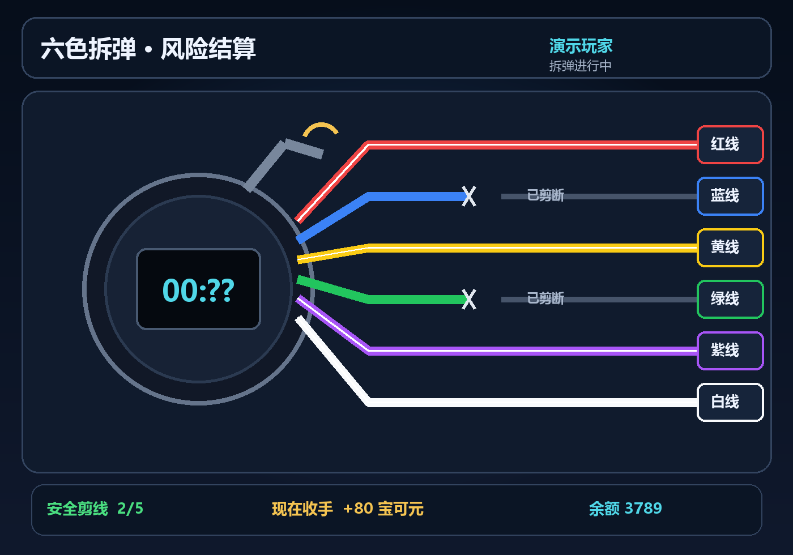
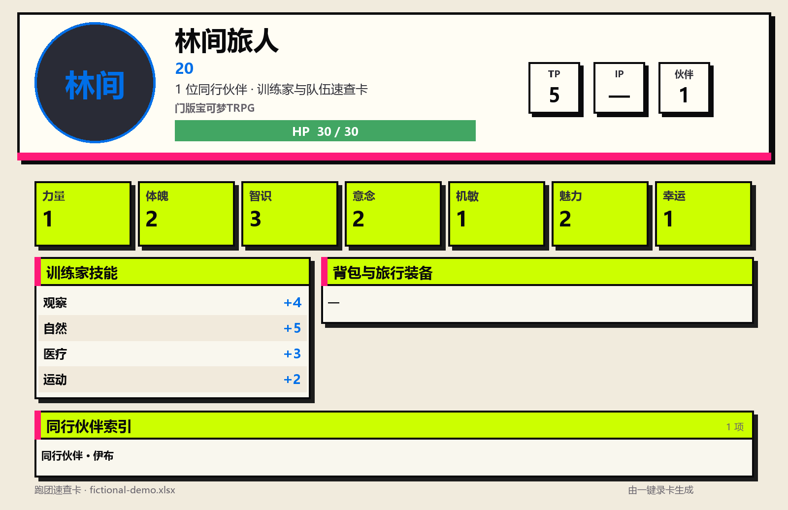

# 艾拉 · SeaDice 插件作品集

面向 TRPG 跑团与 QQ 群互动的插件，由 SNOM（艾拉）维护。这里公开 **六色拆弹、门版宝可梦 TRPG 综合助手、一键录卡** 的源码、使用说明及已有测试。

**我已入驻爱发电，持续制作与维护艾拉骰娘插件。创作主页：[爱发电 · SNOM / 艾拉](https://afdian.com/a/SNOM6563)。欢迎关注项目进展，或支持后续开发。**

[艾拉官网](https://ellasealchat.com/) · [支持者致谢](https://ellasealchat.com/thanks/)

## 三个插件

| 插件 | 版本 | 主要功能 |
| --- | --- | --- |
| [六色拆弹](plugins/bomb-defusal/) | 1.0.0 | 六色剪线、逐步加奖、随时收手、QQ 图文按钮、每日限制与结算去重 |
| [门版宝可梦 TRPG 综合助手](plugins/pokemon-assistant/) | 1.39.1 | 训练家属性、D20 检定、完整队伍、组合伤害骰、原生旅伴卡与自动名片 |
| [一键录卡](plugins/autocard/) | 0.9.14 | Excel 模板识别、角色属性导入、训练家与伙伴卡图、嵌入头像提取、可选背景故事评分 |

## 六色拆弹

每局六根线，其中一根是随机错误线。选择继续剪线提升奖励，或随时收手结算；交易编号避免重复点击造成重复记账。此处的宝可元是跑团机器人中的虚拟游戏币。

入口：`.拆弹`、`.拆弹 开始`、`.拆弹 剪 红`、`.拆弹 收手`。

## 门版宝可梦 TRPG 综合助手

围绕训练家与伙伴队伍的跑团流程，提供属性录入、检定、队伍切换、命中与伤害骰、技能和名片更新。与一键录卡配合，可将训练家与完整伙伴队伍存入当前绑定的旅伴角色卡。

常用入口：`.set pkm`、`.pc new 角色名`、`.pst`、`.pm`、`.宝可梦队伍`、`.宝可梦伤害`、`.sn pkm`、`.th`。

**原生旅伴卡依赖艾拉自编译核心的角色卡接口。** 仓库只公开插件，不附带私人核心，也不保证标准 SeaDice 核心能直接运行全部功能。原有共同作者署名保留。

## 一键录卡

玩家主动选择上传的 Excel 文件后，识别 DND、COC、门版宝可梦等模板；确认后写入当前角色卡，并生成现场查数用的速查图。支持 `.xls`、`.xlsx`、`.xlsm` 的数据读取，不执行宏。

0.9.14 包含 OOXML Rich Data 单元格图片提取，处理部分表格中训练家或宝可梦头像无法识别的情况。可选的 AI 背景故事评分需自行配置兼容接口。

入口：`.一键录卡 列表`、`.一键录卡 导入 最新`、`.一键录卡 同意`、`.一键录卡 卡图`。

## 使用前

请阅读各插件目录内的 README。公开副本中的 `example.com` 是部署占位地址；API 令牌由部署者自行配置。官方 QQ 图文按钮、原生旅伴角色卡、宝可元结算分别依赖相应核心接口和插件。

一键录卡公开源码包含解析器、绘图后端与 JS；没有打包玩家表格、头像档案、生产配置或外部图标素材。没有可选图标和背景包时，绘图代码使用内置底色与文字布局。

测试方法见 [验证说明](docs/VALIDATION.md)。来源和授权边界见 [来源说明](THIRD_PARTY_NOTICES.md)。

## 支持与反馈

如果这些插件帮到了你的跑团，欢迎到 [爱发电支持 SNOM / 艾拉](https://afdian.com/a/SNOM6563)。也欢迎通过 GitHub Issues 提交可复现的问题；反馈前请删除密钥、QQ / OpenID、群聊记录和私人角色卡。
